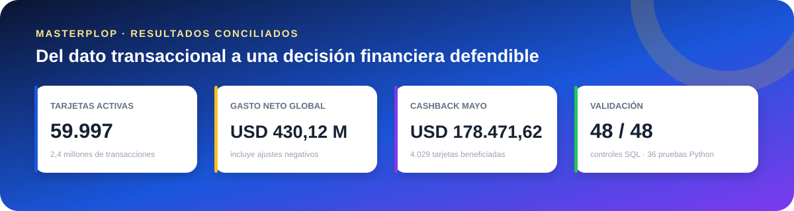
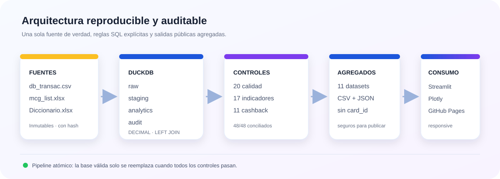

<p align="center">
  <a href="https://cesarxbox32.github.io/masterplop-analytics-engineering/" title="Abrir dashboard ejecutivo">
    
  </a><br>
  <strong><a href="https://cesarxbox32.github.io/masterplop-analytics-engineering/">🌐 Ver dashboard ejecutivo en vivo</a></strong>
</p>

<h1 align="center">Masterplop Analytics Engineering</h1>

<p align="center">
  Pipeline auditable en DuckDB, cinco KPIs ejecutivos y conciliación monetaria de la campaña de cashback de mayo de 2024.
</p>

<p align="center">
  <a href="https://cesarxbox32.github.io/masterplop-analytics-engineering/"></a>
  <a href="https://github.com/cesarxbox32/masterplop-analytics-engineering/actions/workflows/pages.yml"></a>
  <a href="https://github.com/cesarxbox32/masterplop-analytics-engineering/actions/workflows/quality.yml"></a>
  
  
</p>

<p align="center">
  <a href="#contexto-y-objetivo-de-negocio">Metodología</a>
  · <a href="#resultados-validados">Resultados</a>
  · <a href="#cashback-oficial--mayo-2024">Cashback</a>
  · <a href="#ejecución-reproducible-en-windows--powershell">Ejecutar</a>
  · <a href="#ai-log">AI Log</a>
</p>



> **Resultado principal:** el costo oficial de la campaña es **USD 178.471,62**, con **4.029 tarjetas beneficiadas** y **2.676 tarjetas alcanzando el tope de USD 50**.

## Tabla de contenidos

- [Contexto y objetivo](#contexto-y-objetivo-de-negocio)
- [Arquitectura](#arquitectura)
- [Ejecución reproducible](#ejecución-reproducible-en-windows--powershell)
- [Dashboard ejecutivo](#dashboard-ejecutivo)
- [Reglas de transformación](#reglas-de-transformación)
- [Indicadores](#indicadores-y-decisiones-de-negocio)
- [Resultados validados](#resultados-validados)
- [Cashback](#cashback-oficial--mayo-2024)
- [Calidad y controles](#matriz-de-controles-verificados)
- [Seguridad y privacidad](#alcance-y-seguridad)
- [Diccionario del modelo](#diccionario-breve-del-modelo-final)
- [Riesgos y recomendaciones](#riesgos-limitaciones-y-recomendaciones)
- [AI Log](#ai-log)
- [Dashboard publicado](#enlace-al-dashboard)

## Contexto y objetivo de negocio

Masterplop necesita transformar un archivo transaccional heterogéneo en información confiable para gerentes de banca. La solución explica actividad, gasto, comportamiento regional, mezcla de comercios y adopción contactless; además, estima con precisión monetaria el costo de una campaña de cashback.

La implementación privilegia la conciliación: conserva valores brutos, documenta cada normalización, no elimina ajustes negativos, mantiene claves sin maestro y separa las fórmulas productivas de los valores de referencia utilizados en pruebas.

## Arquitectura



- **`raw`:** copia inmutable de las 12 columnas del CSV como texto y del maestro MCG leído desde Excel.
- **`staging`:** tipado explícito y normalización de identificadores, montos, flags, fechas, horas, productos y países.
- **`analytics`:** hecho transaccional enriquecido mediante `LEFT JOIN`, vistas de KPIs y cálculo individual de cashback.
- **`audit`:** hashes, perfil de fuentes, duplicados y 48 controles SQL contra referencias independientes.
- **`dashboard`:** 11 agregados físicos sin identificadores individuales, exportados también a CSV/JSON para consumo público.

`card_id` permanece como `VARCHAR` en las capas internas. El CSV original y DuckDB no se versionan; las salidas públicas tienen grano agregado.

## Estructura

```text
.
├── .github/workflows/             # publicación Pages y control de entrega
├── dashboard/
│   ├── app.py                     # aplicación principal Streamlit + Plotly
│   └── data_access.py             # DuckDB con fallback a agregados públicos
├── data/processed/
│   ├── dashboard/                 # 11 datasets públicos seguros
│   ├── kpis/                      # cinco indicadores exportados
│   ├── cashback_may_2024.*
│   └── quality_summary.*
├── docs/assets/                   # infografías utilizadas en esta documentación
├── sql/                           # ingesta, staging, analytics, KPIs y controles
├── src/pipeline.py                # orquestación reproducible y reemplazo atómico
├── tests/                         # calidad, KPIs, cashback, privacidad y dashboard
├── index.html                     # dashboard ejecutivo publicado en GitHub Pages
├── requirements.txt
└── README.md
```

## Ejecución reproducible en Windows / PowerShell

Con Python 3.11 o superior instalado:

```powershell
py -3.12 -m venv .venv
& ".\.venv\Scripts\python.exe" -m pip install --upgrade pip
& ".\.venv\Scripts\python.exe" -m pip install -r requirements.txt
& ".\.venv\Scripts\python.exe" ".\src\pipeline.py"
& ".\.venv\Scripts\python.exe" -m pytest -q
```

En este workspace también puede usarse el runtime aislado preparado durante la ejecución:

```powershell
& ".\.runtime\python\python.exe" ".\src\pipeline.py"
& ".\.runtime\python\python.exe" -m pytest -q
```

El pipeline construye primero `masterplop.building.duckdb` y reemplaza atómicamente la base generada solo después de completar los controles. Nunca sobrescribe los cinco archivos fuente.

## Dashboard ejecutivo

La solución ofrece dos interfaces complementarias sobre los mismos agregados validados:

- **GitHub Pages:** versión ejecutiva pública en HTML, CSS y Plotly, optimizada para escritorio, tablet y móvil. Consume `data/processed/dashboard/manifest.json`, permite enlaces directos por sección y nunca consulta el CSV transaccional.
- **Streamlit:** aplicación analítica para ejecución local. Utiliza las tablas físicas pequeñas del esquema `dashboard` y, si DuckDB no está disponible, cambia automáticamente a los CSV agregados seguros de `data/processed/dashboard/`.

Ambas interfaces trabajan con grano agregado y no contienen `card_id` ni registros transaccionales individuales.

> **Acceso directo:** [Resumen ejecutivo](https://cesarxbox32.github.io/masterplop-analytics-engineering/) · [Análisis transaccional](https://cesarxbox32.github.io/masterplop-analytics-engineering/#transactions) · [Campaña mayo 2024](https://cesarxbox32.github.io/masterplop-analytics-engineering/#campaign)

### Estructura

- **Resumen Ejecutivo:** seis métricas consolidadas, hallazgos dinámicos, concentración MCG y adopción contactless.
- **Análisis Transaccional:** volumen por trimestre y tipo, ticket trimestral de crédito, ticket regional por país emisor y producto, Top 10 MCG y adopción contactless. Los filtros indican explícitamente qué visualizaciones afectan.
- **Campaña Mayo 2024:** resultado fijo de cashback, beneficiarios, tarjetas topadas, gasto elegible, conciliación por tope, sensibilidad sin devoluciones y diagnóstico de `is_xb`.

La campaña no responde a filtros de otros períodos. Las fechas reales disponibles son 2024 T1 y 2024 T2; no se presentan T3 ni T4.

### Iniciar en Windows / PowerShell

Primero reconstruye los agregados y ejecuta las pruebas:

```powershell
& ".\.venv\Scripts\python.exe" ".\src\pipeline.py"
& ".\.venv\Scripts\python.exe" -m pytest -q
```

Luego inicia Streamlit:

```powershell
& ".\.venv\Scripts\python.exe" -m streamlit run ".\dashboard\app.py"
```

Con el runtime aislado incluido en este workspace:

```powershell
& ".\.runtime\python\python.exe" ".\src\pipeline.py"
& ".\.runtime\python\python.exe" -m pytest -q
& ".\.runtime\python\python.exe" -m streamlit run ".\dashboard\app.py"
```

Abre `http://localhost:8501`. Si falta DuckDB, la aplicación utiliza los agregados versionados; si ambas fuentes faltan, muestra un mensaje controlado con la instrucción de reconstrucción.

## Reglas de transformación

- El CSV se lee inicialmente como UTF-8 y todas sus columnas como `VARCHAR`; el encabezado se valida contra las 12 columnas esperadas.
- `Credit`, `Credito` y `Crédito` se normalizan a `Crédito`. `Debit`, `Debito` y `Débito` se normalizan a `Débito`.
- Se unifican las variantes solicitadas de Brasil, México, Perú, Panamá y República Dominicana. Otros países se conservan sin inferencias.
- Las fechas se parsean solo como `DD/MM/YYYY` o `DD-MM-YYYY`. Las horas se parsean solo como `HH:MM:SS` o `HH.MM.SS`.
- `amt` se convierte con `try_cast` a `DECIMAL(18,2)`. Los montos negativos se conservan.
- `mcg_id` se une a `mcg` mediante `LEFT JOIN`. Una clave sin maestro recibe `mcg_name = 'Sin clasificar'` y mantiene `mcg_code_original`.
- `is_xb` original se conserva. `is_xb_derived` e `is_xb_consistent` sirven solo para calidad de datos. No se usan para inferir cashback.
- No se eliminan transacciones, no se imputan categorías y no se deducen valores faltantes.

## Indicadores y decisiones de negocio

### 1. Volumen

`analytics.kpi_volume_quarterly` cuenta `COUNT(DISTINCT card_id)` por año, trimestre calendario y tipo normalizado. Mide tarjetas activas, no cantidad de transacciones. `transaction_count` se incluye como columna auxiliar con un nombre explícito y no se usa como volumen de tarjetas. La vista solo presenta tipos observados; no crea filas de prepago.

### 2. Ticket trimestral de crédito

`analytics.kpi_credit_ticket_quarterly` calcula:

```text
SUM(amt de crédito) / COUNT(DISTINCT card_id de crédito)
```

El numerador es gasto neto. Conserva devoluciones y otros ajustes negativos porque eliminarlos sobrestimaría el gasto económico atribuible a cada tarjeta activa. El denominador se calcula dentro del mismo año y trimestre.

### 3. Ticket regional

`analytics.kpi_credit_ticket_south_america` calcula `AVG(amt)` por `ctry_card` y `product_name`, solo para crédito y países sudamericanos. Es un promedio por transacción. Se eligió `ctry_card` porque representa el mercado de emisión y permite comparar el comportamiento de la cartera de cada país, independientemente del país del comercio.

### 4. Top comercios por MCG

`analytics.kpi_mcg_spend_all` agrega todas las categorías y conserva el código original 35 como `Sin clasificar`. `analytics.kpi_top_10_mcg_spend` selecciona las diez categorías con mayor gasto neto. La participación es:

```text
SUM(amt neto de la categoría) / SUM(amt neto global) * 100
```

El denominador global contiene las 2.400.000 transacciones, incluidos los registros sin correspondencia en el maestro MCG. Así se evita inflar artificialmente la participación de las categorías clasificadas.

### 5. Adopción contactless

`analytics.kpi_contactless_adoption` calcula por país emisor normalizado:

```text
SUM(amt cuando is_contactless = 1) / NULLIF(SUM(amt total), 0) * 100
```

El indicador mide participación de gasto neto, no participación de transacciones. `NULLIF` devuelve `NULL` si el denominador es cero. La exportación queda ordenada de mayor a menor porcentaje.

Todos los montos se mantienen como `DECIMAL`; los montos unitarios se muestran con dos decimales y los porcentajes con cuatro decimales.

## Resultados validados

| Indicador | Resultado |
|---|---:|
| Volumen 2024 T1 Crédito | 46.747 tarjetas |
| Volumen 2024 T1 Débito | 8.224 tarjetas |
| Volumen 2024 T2 Crédito | 51.037 tarjetas |
| Volumen 2024 T2 Débito | 8.960 tarjetas |
| Ticket crédito 2024 T1 | USD 3.229,40 |
| Ticket crédito 2024 T2 | USD 5.019,38 |
| Gasto neto global | USD 430.124.709,40 |
| Groceries and Supermarkets | 22,1646% |
| Restaurants and Dining | 17,1222% |
| Entertainment | 13,4029% |

Los valores esperados están únicamente en `audit.kpi_checks`; ninguna vista KPI los utiliza para calcular resultados.

## Cashback oficial — mayo 2024

La implementación vive en `sql/27_cashback.sql` y separa las siguientes capas:

1. `analytics.cashback_may_2024_eligible_transactions`: transacciones que cumplen fecha, crédito, emisor Chile y comercio fuera de Chile.
2. `analytics.cashback_may_2024_by_card`: gasto mensual neto agregado por tarjeta.
3. `analytics.cashback_may_2024_individual`: piso cero, 7%, tope y redondeo individual.
4. `analytics.cashback_may_2024_summary`: resultado oficial agregado y seguro.

Las vistas con `card_id` son internas y permanecen dentro de DuckDB. `cashback_may_2024.json` y `cashback_may_2024.md` contienen únicamente agregados.

### Fórmula oficial

```text
cashback por tarjeta = ROUND(
    LEAST(50, GREATEST(0, gasto mensual neto por tarjeta × 0,07)),
    2
)
```

- Se usa `ctry_mrch <> 'Chile'` porque la campaña define elegibilidad por país del comercio. `is_xb` no participa en el filtro y se conserva como diagnóstico.
- Se agrupa antes por tarjeta porque el tope de USD 50 corresponde al total mensual de cada tarjeta, no a cada transacción ni al portafolio completo.
- Las devoluciones y ajustes negativos reducen el gasto elegible. Esto representa el desembolso neto real de la tarjeta durante mayo.
- Se redondea cada cashback individual a centavos antes de sumar, como requiere una liquidación monetaria por beneficiario.
- El costo total no es 7% del gasto global: cada tarjeta tiene piso cero, tope de USD 50 y redondeo propio.

### Resultado y conciliación

| Medida | Resultado |
|---|---:|
| Transacciones elegibles | 28.915 |
| Transacciones positivas | 28.885 |
| Transacciones negativas | 30 |
| Tarjetas beneficiadas | 4.029 |
| Tarjetas topadas | 2.676 |
| Gasto neto elegible | USD 7.319.379,70 |
| Cashback individual sin tope | USD 512.358,63 |
| Ahorro producido por el tope | USD 333.887,01 |
| **Costo total oficial** | **USD 178.471,62** |

El 7% directo del gasto neto global sería USD 512.356,58. La diferencia frente al cashback individual sin tope se debe al redondeo por tarjeta. Después, el tope reduce el costo a USD 178.471,62. Si se redondeara solo después de sumar los importes topados, el resultado sería USD 178.470,91, USD 0,71 menos que la política oficial.

### Sensibilidades y diagnóstico de `is_xb`

| Escenario | Cashback | Diferencia frente al oficial |
|---|---:|---:|
| Oficial, gasto neto | USD 178.471,62 | — |
| Excluir devoluciones | USD 178.608,88 | +USD 137,26 |
| Usar incorrectamente `is_xb=1` | USD 135.160,88 | -USD 43.310,74 |

El flag omitiría 14.521 transacciones que sí son elegibles por geografía e incluiría erróneamente 1.261 transacciones cuyo comercio está en Chile. Por esta razón no puede sustituir a `ctry_mrch`.

Los casos sin compras, saldo negativo, compra pequeña, umbral y gasto superior al tope se ejecutan en `audit.cashback_boundary_tests`. Los resultados de referencia están únicamente en `audit.cashback_checks`, separados de la fórmula productiva.

## Consultas de inspección

```sql
SELECT * FROM audit.quality_checks ORDER BY status, check_name;

SELECT
    product_type_raw,
    product_type,
    count(*) AS transactions
FROM staging.transactions
GROUP BY 1, 2
ORDER BY 1;

SELECT
    mcg_code_original,
    mcg_name,
    count(*) AS transactions
FROM analytics.transactions_enriched
WHERE NOT is_mcg_classified
GROUP BY 1, 2;

SELECT *
FROM analytics.kpi_volume_quarterly
ORDER BY period_year, period_quarter, product_type;

SELECT *
FROM analytics.kpi_top_10_mcg_spend
ORDER BY spend_rank;

SELECT *
FROM audit.kpi_checks
ORDER BY status, check_name;

SELECT *
FROM analytics.cashback_may_2024_summary;

SELECT *
FROM analytics.cashback_may_2024_sensitivity_summary;

SELECT *
FROM analytics.cashback_may_2024_is_xb_summary;

SELECT *
FROM audit.cashback_checks
ORDER BY status, check_name;
```

## Alcance y seguridad

La base DuckDB contiene el detalle necesario para análisis interno, incluido `card_id`; por eso está excluida de Git. Los CSV, JSON y Markdown versionados tienen grano agregado y no contienen identificadores individuales. GitHub Pages consume exclusivamente el manifiesto público de 11 datasets; Streamlit usa DuckDB cuando está disponible y hace fallback a los mismos agregados seguros.

## Tecnologías utilizadas

- **DuckDB 2.0:** motor SQL embebido, tipado `DECIMAL` y base analítica local.
- **Python 3.12:** orquestación, lectura controlada de Excel, hashes, exportaciones y pruebas.
- **pytest:** pruebas de datos, KPIs, cashback, seguridad de salidas y render de la aplicación.
- **Streamlit y Plotly:** dashboard ejecutivo interactivo sobre agregados materializados.
- **openpyxl y pandas:** integración con maestros y consumo tabular de resultados agregados.
- **GitHub Pages y Actions:** publicación pública, HTTPS y validación continua del contrato de entrega.

## Diccionario breve del modelo final

| Campo / objeto | Tipo o grano | Significado |
|---|---|---|
| `source_row_number` | `BIGINT` | Trazabilidad técnica a la fila del CSV; no se publica. |
| `card_id` | `VARCHAR` | Identificador de tarjeta conservado como texto; solo en capas internas. |
| `prch_date`, `prch_time` | `DATE`, `TIME` | Fecha y hora parseadas desde los dos formatos admitidos. |
| `amt` | `DECIMAL(18,2)` | Importe USD, incluidos ajustes negativos. |
| `product_type` | `VARCHAR` | Tipo normalizado: `Crédito` o `Débito`; no se inventa prepago. |
| `ctry_card` | `VARCHAR` | País emisor normalizado; define mercado para indicadores regionales. |
| `ctry_mrch` | `VARCHAR` | País del comercio normalizado; define elegibilidad geográfica del cashback. |
| `mcg_id`, `mcg_code_original` | `INTEGER`, `VARCHAR` | Código tipado y valor original del grupo comercial. |
| `mcg_name` | `VARCHAR` | Categoría del maestro o `Sin clasificar` si no existe coincidencia. |
| `is_xb` | `TINYINT` | Flag de fuente, preservado pero no usado para cashback. |
| `is_xb_derived`, `is_xb_consistent` | diagnóstico | Comparación de países y consistencia contra el flag de fuente. |
| `analytics.transactions_enriched` | una fila por transacción | Hecho enriquecido mediante `LEFT JOIN`, sin pérdida de registros. |
| `analytics.kpi_*` | agregado por KPI | Vistas reutilizables con las cinco definiciones solicitadas. |
| `dashboard.*` | agregado seguro | Tablas pequeñas consumidas por Streamlit, sin `card_id`. |

## Matriz de controles verificados

Verificación ejecutada sobre los archivos fuente disponibles el **6 de noviembre de 2026**. Los valores esperados viven en el esquema `audit`; no intervienen en las fórmulas.

| Control | Resultado observado | Estado |
|---|---:|:---:|
| Transacciones en raw / staging / analytics | 2.400.000 / 2.400.000 / 2.400.000 | PASS |
| Columnas originales | 12 | PASS |
| Tarjetas distintas | 59.997 | PASS |
| Período | 2024-01-01 a 2024-06-30 | PASS |
| Crédito / Débito normalizados | 2.040.959 / 359.041 | PASS |
| Transacciones negativas | 2.400 | PASS |
| MCG 35 sin maestro, preservado | 12.000 | PASS |
| Discrepancias `is_xb` vs. países | 1.440.451 | PASS |
| Filas idénticas duplicadas | 0 | PASS |
| Fechas inválidas | 0 | PASS |
| Controles SQL de datos | 20 de 20 | PASS |
| Controles SQL de KPIs | 17 de 17 | PASS |
| Controles SQL de cashback | 11 de 11 | PASS |
| Pruebas Python | 36 de 36 | PASS |
| Dashboard y manifiesto públicos | HTTP 200 / HTTP 200 | PASS |

## Riesgos, limitaciones y recomendaciones

- La fuente cubre solo enero-junio de 2024; T3 y T4 no deben proyectarse ni presentarse como observados.
- No existe producto prepago en la fuente. Agregarlo requeriría nueva evidencia, no una inferencia.
- El código MCG 35 no está en el maestro. Se conserva como `Sin clasificar`; se recomienda solicitar su definición al dueño del dato.
- `is_xb` contradice la geografía normalizada en 1.440.451 filas. Debe investigarse su linaje y no reutilizarse como regla de elegibilidad.
- El CSV fuente y la base DuckDB contienen identificadores individuales y no se versionan. Un clon puede ejecutar y revisar el dashboard con los agregados públicos; para reconstruir toda la base necesita recibir el CSV por un canal seguro.
- GitHub Pages es una vista pública de solo lectura. Streamlit sigue siendo la aplicación principal para exploración local y puede desplegarse más adelante si se requiere ejecución Python administrada.
- La automatización pública valida documentación y artefactos seguros. Las pruebas completas del pipeline se ejecutan localmente porque el CSV transaccional no debe almacenarse en GitHub Actions.

## Política del repositorio

`.gitignore` excluye el CSV transaccional, bases DuckDB, archivos temporales, entornos, secretos, credenciales y claves. Se mantienen versionables el SQL, Python, pruebas, `requirements.txt`, documentación, maestros suministrados y activos de marca. Ninguna exportación pública debe contener `card_id`.

## AI Log

Se utilizaron prompts de IA como apoyo para auditar anomalías, proponer transformaciones SQL, enumerar casos extremos del cashback, construir la visualización y revisar la documentación. La IA ayudó a detectar riesgos concretos —por ejemplo, pérdida por joins, redondeo después de sumar, uso incorrecto de `is_xb` y exposición de identificadores— y a convertirlos en consultas y pruebas ejecutables.

La evidencia aceptada no depende de una respuesta de IA: cada cifra se recalcula desde las fuentes mediante SQL y se contrasta con controles automatizados. El candidato debe revisar personalmente y poder justificar antes de presentar, como mínimo: uso de `ctry_mrch` en la campaña, agregación y tope por tarjeta, redondeo individual, descuento de devoluciones, uso de `ctry_card` como mercado regional y denominador global del ranking MCG. La responsabilidad final sobre las decisiones, la interpretación comercial y la entrega permanece en el candidato.

## Enlace al dashboard

- **Dashboard público:** https://cesarxbox32.github.io/masterplop-analytics-engineering/
- **Análisis transaccional:** https://cesarxbox32.github.io/masterplop-analytics-engineering/#transactions
- **Campaña mayo 2024:** https://cesarxbox32.github.io/masterplop-analytics-engineering/#campaign
- **Código fuente:** https://github.com/cesarxbox32/masterplop-analytics-engineering

La publicación ejecutiva en GitHub Pages consume exactamente los agregados seguros generados por el pipeline. Su interfaz es responsive, permite navegar con teclado, respeta la preferencia de movimiento reducido y ofrece una tabla accesible detrás de cada gráfico. Streamlit permanece como la aplicación analítica principal para ejecución local o despliegue en un servicio compatible con Python.
