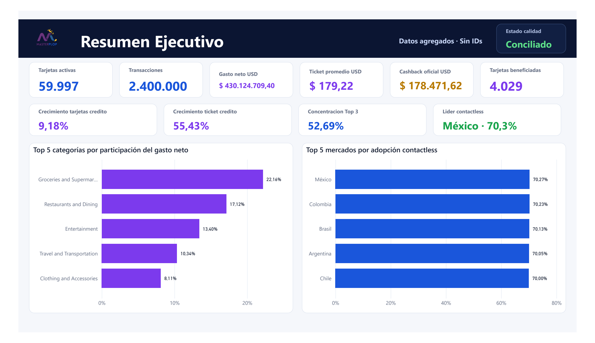
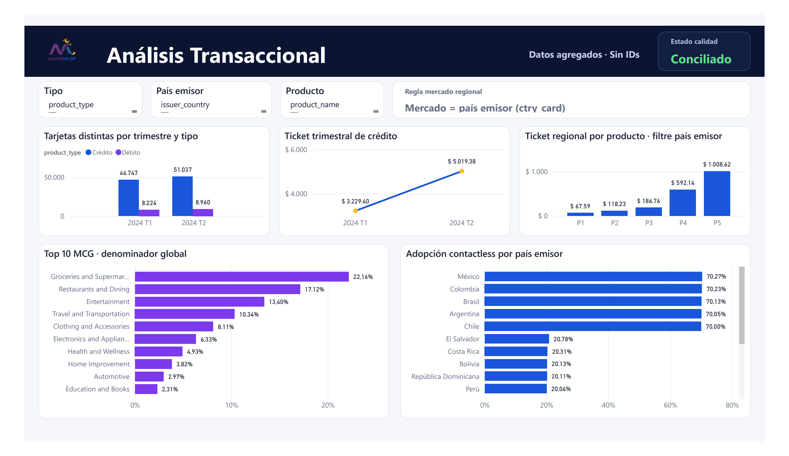
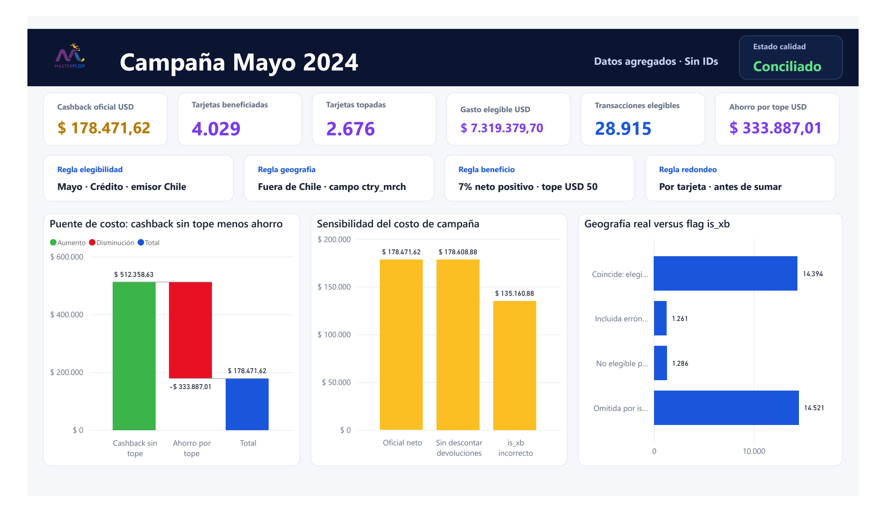

# MASTERPLOP · Power BI Executive Analytics

Reporte ejecutivo complementario construido sobre los mismos agregados financieros conciliados con DuckDB. La entrega pública contiene una copia compilada, una exportación PDF navegable y el proyecto PBIP portable como código auditable.

## Acceso rápido

| Experiencia | Uso | Enlace |
|---|---|---|
| Dashboard web | Revisión inmediata y responsive desde cualquier navegador | [Abrir GitHub Pages](https://cesarxbox32.github.io/masterplop-analytics-engineering/) |
| Vista previa Power BI | Revisar las tres páginas sin instalar software | [Abrir PDF](./Masterplop_Executive.pdf) |
| Power BI Desktop | Explorar filtros, visuales y medidas DAX | [Descargar PBIX](./Masterplop_Executive.pbix) |
| Proyecto auditable | Inspeccionar o regenerar PBIR, TMDL y consultas M | [Abrir PBIP portable](./source/Masterplop_Executive.pbip) |

> GitHub no ejecuta archivos .pbix de forma interactiva. En el repositorio se muestran capturas y el PDF exportado; la interacción completa requiere Power BI Desktop. No se publicó en Power BI Service y no se presenta un enlace ficticio.

## Vista previa

### 1 · Resumen Ejecutivo

### 2 · Análisis Transaccional

### 3 · Campaña Mayo 2024

## Contenido del reporte

El modelo consume exclusivamente resultados agregados y conciliados. No relee las 2,4 millones de transacciones en cada interacción y no contiene card_id.

- **3 páginas ejecutivas.**
- **49 visuales.**
- **15 tablas agregadas.**
- **39 medidas DAX.**
- Formatos financieros en USD y porcentajes.
- Filtros por tipo, país emisor y producto donde corresponde.
- Campaña de mayo fija, independiente de filtros de otros períodos.

### Resumen Ejecutivo

Presenta tarjetas activas, transacciones, gasto neto, ticket promedio, costo de cashback y tarjetas beneficiadas. Incluye concentración de categorías MCG y adopción contactless.

### Análisis Transaccional

Incluye los cinco indicadores solicitados:

1. tarjetas distintas por año, trimestre y tipo normalizado;
2. gasto neto de crédito por tarjeta activa;
3. ticket regional promedio por transacción, definido por país emisor;
4. Top 10 MCG con denominador de gasto neto global y Sin clasificar;
5. adopción contactless por país emisor, con control de denominador cero.

Solo se muestran 2024 T1 y 2024 T2, que son los períodos observados.

### Campaña Mayo 2024

Expone el costo oficial, beneficiarios, tarjetas topadas, gasto elegible, ahorro por tope, sensibilidad sin devoluciones y diagnóstico del error de usar is_xb.

La elegibilidad usa ctry_mrch distinto de Chile; el gasto se agrega por tarjeta, se aplica piso cero, 7%, tope USD 50 y redondeo individual antes de sumar.

## Arquitectura portable

~~~text
Pipeline Python + SQL DuckDB
            │
            ▼
Agregados conciliados y seguros
data/processed/dashboard/
            │
            ▼
Generador reproducible
powerbi/generate_masterplop_powerbi.js
            │
            ├── 15 CSV agregados
            └── consultas M con CSV embebido en Base64
                        │
                        ▼
Proyecto PBIP portable · PBIR + TMDL
powerbi/source/
                        │
                        ▼
PBIX compilado + PDF + capturas
~~~

Las consultas M usan Binary.FromText con BinaryEncoding.Base64. Esto evita rutas absolutas como C:\Users\..., mantiene el PBIP autocontenido y permite revisar el modelo desde otro equipo.

## Estructura pública

~~~text
powerbi/
├── Masterplop_Executive.pbix          # reporte compilado
├── Masterplop_Executive.pdf           # tres páginas exportadas
├── source/
│   ├── Masterplop_Executive.pbip      # punto de entrada portable
│   ├── Masterplop_Executive.Report/   # definición PBIR y logo
│   ├── Masterplop_Executive.SemanticModel/
│   │   └── definition/                # modelo TMDL y medidas DAX
│   └── data/                          # 15 agregados seguros
├── generate_masterplop_powerbi.js     # regeneración reproducible
├── validate_powerbi.ps1               # controles técnicos y financieros
├── README_POWERBI.md
└── VALIDACION_POWERBI.md
~~~

Los directorios heredados ubicados directamente en powerbi/Masterplop_Executive.Report, powerbi/Masterplop_Executive.SemanticModel, powerbi/data y powerbi/Masterplop_Executive.pbip son copias locales de autoría y continúan ignorados. La fuente pública canónica es powerbi/source/.

También quedan excluidos todos los cachés .pbi, cache.abf, configuraciones locales del editor y cualquier otro .pbix o .pbit no aprobado.

## Abrir en Windows / PowerShell

Requiere Power BI Desktop 2.159 o posterior.

### Opción 1 · Reporte compilado

~~~powershell
Start-Process -FilePath ".\powerbi\Masterplop_Executive.pbix"
~~~

### Opción 2 · Proyecto como código

~~~powershell
Start-Process -FilePath ".\powerbi\source\Masterplop_Executive.pbip"
~~~

### Opción 3 · Vista previa sin Power BI

~~~powershell
Start-Process -FilePath ".\powerbi\Masterplop_Executive.pdf"
~~~

## Regenerar el PBIP

Node.js se requiere únicamente para reconstruir el proyecto:

~~~powershell
node ".\powerbi\generate_masterplop_powerbi.js"
~~~

El generador:

1. copia solo los agregados requeridos;
2. genera consultas M autocontenidas;
3. reconstruye PBIR y TMDL en powerbi/source/;
4. incorpora el logo oficial;
5. conserva el PBIX aprobado hasta que se decida recompilarlo en Power BI Desktop.

Para probar el generador en otra ruta sin tocar la entrega:

~~~powershell
$env:MASTERPLOP_POWERBI_OUTPUT_ROOT = Join-Path $PWD "tmp\powerbi-check"
node ".\powerbi\generate_masterplop_powerbi.js"
Remove-Item Env:\MASTERPLOP_POWERBI_OUTPUT_ROOT
~~~

## Validar

~~~powershell
powershell.exe -NoProfile -ExecutionPolicy Bypass -File ".\powerbi\validate_powerbi.ps1"
& ".\.runtime\python\python.exe" -m pytest tests -q --basetemp tmp/pytest-powerbi -p no:cacheprovider
~~~

El validador comprueba estructura, JSON, 3 páginas, 49 visuales, 15 tablas, 39 medidas, consultas M portables, cifras de control, privacidad y reglas de publicación Git.

## Conciliación esperada

| Control | Resultado |
|---|---:|
| Transacciones | 2.400.000 |
| Tarjetas activas | 59.997 |
| Gasto neto global | USD 430.124.709,40 |
| Ticket promedio | USD 179,22 |
| Volumen T1 · Crédito / Débito | 46.747 / 8.224 |
| Volumen T2 · Crédito / Débito | 51.037 / 8.960 |
| Ticket crédito T1 / T2 | USD 3.229,40 / USD 5.019,38 |
| Transacciones elegibles | 28.915 |
| Gasto neto elegible | USD 7.319.379,70 |
| Tarjetas beneficiadas / topadas | 4.029 / 2.676 |
| **Costo oficial** | **USD 178.471,62** |
| Escenario sin devoluciones | USD 178.608,88 |
| Escenario incorrecto con is_xb | USD 135.160,88 |

Los valores se obtienen de los agregados generados por el pipeline. No están hardcodeados en los visuales.

## Privacidad y publicación

- No se publican IDs de tarjeta ni transacciones individuales.
- No se publica el CSV fuente, DuckDB, credenciales ni rutas personales.
- El código M público no usa File.Contents.
- El PBIX aprobado y el PDF contienen únicamente información agregada.
- Las vistas con card_id permanecen dentro de DuckDB y fuera del repositorio.
- GitHub Pages consume los mismos agregados seguros que Power BI.

## Decisiones de modelado

- **País emisor:** define mercado para ticket regional y contactless.
- **Gasto neto:** incluye ajustes negativos para reflejar el efecto financiero real.
- **MCG desconocido:** se conserva mediante LEFT JOIN como Sin clasificar, incluido el código 35.
- **Cashback:** se agrega por tarjeta antes del máximo y se redondea individualmente.
- **Geografía:** usa países normalizados; is_xb es solo un control de calidad.
- **Precisión:** DuckDB calcula montos oficiales con DECIMAL; Power BI consume los resultados conciliados.

## Estado

Paquete preparado para distribución por GitHub el **7 de noviembre de 2026**. Consulte [VALIDACION_POWERBI.md](./VALIDACION_POWERBI.md) para la evidencia y los comandos de control.
